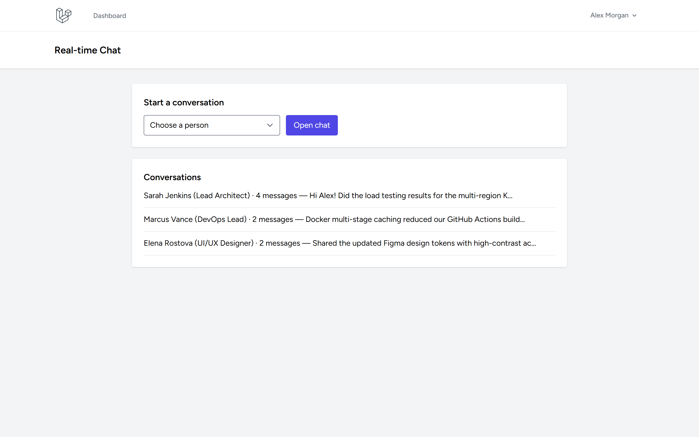
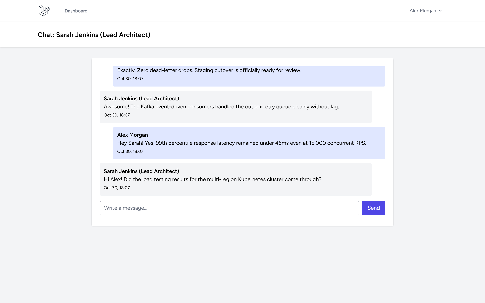
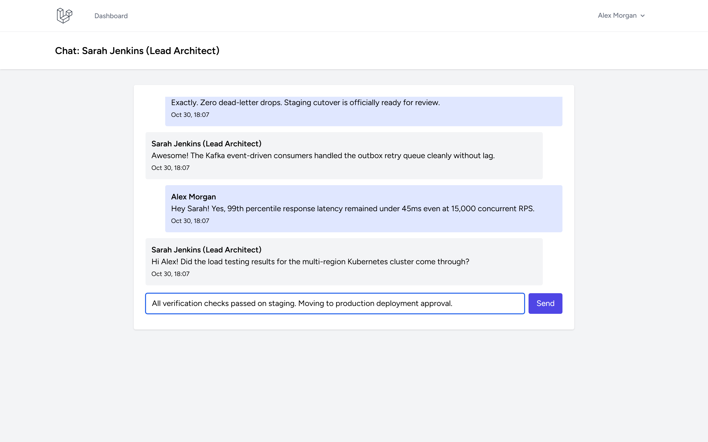
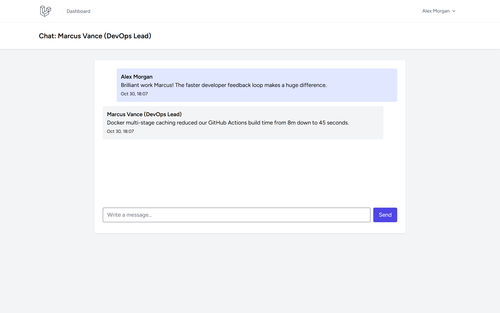

# Real-time Chat Laravel

Authenticated one-to-one messaging with persisted conversations/messages and browser polling every two seconds. No fabricated sample messages or external realtime service required.

---

## Screenshots

| Tampilan | Preview |
|---|---|
| **Kotak Masuk Pesan & Saluran Percakapan**<br>Daftar percakapan aktif dengan ringkasan jumlah pesan, cuplikan pesan terakhir, dan formulir inisiasi percakapan baru |  |
| **Utas Percakapan Real-Time Aktif**<br>Tampilan obrolan langsung dengan gelembung pesan masuk/keluar terbedakan, nama pengirim, dan cap waktu pesan |  |
| **Komposer Pesan & Alur Pengiriman Pesan**<br>Interaksi pengiriman pesan instan dengan kotak input teks, tombol kirim, dan mekanisme polling sinkronisasi real-time |  |
| **Saluran Kolaborasi Tim & Diskusi Teknis**<br>Diskusi kolaboratif lintas peran (DevOps & Arsitektur Cloud) dalam peninjauan implementasi infrastruktur sistem |  |

---

## Local setup (Windows)

```powershell
Copy-Item .env.example .env
php C:/Users/wondr/.config/herd-lite/bin/composer.phar install
npm install
php artisan key:generate
php artisan migrate --seed
npm run build
php artisan serve
```

Register two accounts and start a chat at `/chat`. Existing one-to-one conversations are reused. Only members can view history, poll, or post; unauthorized access returns 404. History displays the newest 100 messages; polling returns up to 100 newer messages per request.

## Realtime scope

Delivery uses two-second HTTP polling, not WebSockets. Add Laravel Reverb when deployment needs lower latency or larger concurrent audiences. Group chats, attachments, typing indicators, presence, read receipts, and message editing/deletion are not implemented.

## Verification

```powershell
php artisan migrate:fresh --seed --no-interaction
php artisan view:clear
php artisan view:cache
php artisan test --compact
npm run build
php C:/Users/wondr/.config/herd-lite/bin/composer.phar validate --no-check-publish
php C:/Users/wondr/.config/herd-lite/bin/composer.phar audit
npm audit --omit=dev
```

Keep `.env`, personal data, dependencies, SQLite databases, and build output out of Git. No user or message content is seeded.
